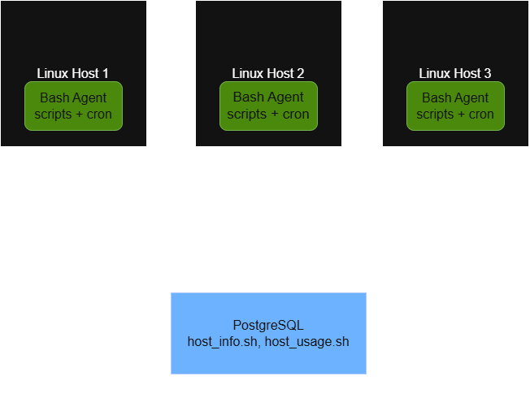

# Linux Cluster Monitoring Agent

## Introduction
This project is a Linux cluster monitoring agent. It gives administrators a record of each server's hardware and of how its resources are used over time. An agent runs on every server in the cluster and reports to one central database. It collects two kinds of data: hardware specifications (CPU, memory and cache), recorded once per server, and resource usage (free memory, CPU load and disk space), recorded every minute. That history supports capacity planning and makes overloaded machines easy to spot.

The project uses Bash for the agent scripts, cron to schedule the minute-by-minute collection, PostgreSQL running in a Docker container (with a volume so the data persists), and Git/GitHub for version control.

## Quick Start
```bash
# Create and start the PostgreSQL container
./scripts/psql_docker.sh create db_username db_password
./scripts/psql_docker.sh start

# Connect to the psql instance (prompts for db_password)
psql -h localhost -U db_username -W

# Inside psql: create and connect to the host_agent database
CREATE DATABASE host_agent;
\c host_agent;
\q

# Create the tables
psql -h localhost -U db_username -d host_agent -f sql/ddl.sql

# Record this host's hardware specs (run once per host)
./scripts/host_info.sh localhost 5432 host_agent db_username db_password

# Record usage data (a single run, for testing)
./scripts/host_usage.sh localhost 5432 host_agent db_username db_password

# Schedule usage collection every minute
crontab -e
# add: * * * * * bash /absolute/path/scripts/host_usage.sh localhost 5432 host_agent db_username db_password > /tmp/host_usage.log
```
Use the same username and password in every command, since they are set when the container is created.

## Implementation

### Architecture


### Scripts
- `psql_docker.sh`: creates, starts, or stops the Postgres container. Reports an
  error if the container already exists or doesn't exist yet.
  ```bash
  ./scripts/psql_docker.sh create db_username db_password
  ./scripts/psql_docker.sh start
  ./scripts/psql_docker.sh stop
  ```
- `host_info.sh`: gathers hardware specs from `lscpu`, `/proc/cpuinfo`, and `vmstat`
  and inserts one row per host.
  ```bash
  ./scripts/host_info.sh localhost 5432 host_agent db_username db_password
  ```
- `host_usage.sh`: gathers current usage with `vmstat` and `df`, looks up the
  host's id by hostname, and inserts a usage row.
  ```bash
  ./scripts/host_usage.sh localhost 5432 host_agent db_username db_password
  ```
- crontab: runs `host_usage.sh` every minute.
  ```bash
  crontab -e
  # add: * * * * * bash /absolute/path/scripts/host_usage.sh localhost 5432 host_agent db_username db_password > /tmp/host_usage.log
  ```

### Database Modeling
**host_info**

| Column | Type | Notes |
|---|---|---|
| id | serial | primary key, auto-generated |
| hostname | varchar | unique, fully qualified |
| cpu_number | int2 | number of CPUs |
| cpu_architecture | varchar | e.g. x86_64 |
| cpu_model | varchar | |
| cpu_mhz | float8 | |
| l2_cache | int4 | in kB |
| timestamp | timestamp | UTC |
| total_mem | int4 | in kB |

**host_usage**

| Column | Type | Notes |
|---|---|---|
| timestamp | timestamp | UTC |
| host_id | int | foreign key to host_info.id |
| memory_free | int4 | in MB |
| cpu_idle | int2 | percent |
| cpu_kernel | int2 | percent |
| disk_io | int4 | I/O operations in progress |
| disk_available | int4 | in MB, root directory |

## Test
Each script was tested as it was written, then the whole chain was run end to end
from empty tables.

**psql_docker.sh** 

Ran `create`, `start`, and `stop` and confirmed each with `docker ps`. Also checked
the error paths: `create` on an existing container, `start` before `create`, a wrong
number of arguments, and an invalid command all printed an error and exited with a
non-zero status. Then connected with `psql` and created the `host_agent` database.

**ddl.sql**

Ran the file against `host_agent`, then used `\dt` to confirm both tables exist and
`\d host_info` and `\d host_usage` to confirm the columns, types, primary key, unique
hostname constraint and foreign key. Re-running the file only produced "already
exists, skipping" notices, so it is safe to run more than once.

**host_info.sh and host_usage.sh**

Both were run with `bash -x` to trace each command, and the generated INSERT
statement was printed before it was sent to make sure values and quoting were correct.
Each command that gathers a value was also run on its own to check that its output
was a single clean value.

- `host_info.sh` inserted one row, and `SELECT * FROM host_info;` showed the expected
  specs.
- `host_usage.sh` inserted a usage row whose `host_id` matched the `host_info` id.

**crontab**

After scheduling `host_usage.sh` every minute, a new row appeared in `host_usage`
each minute, with the log file empty when runs succeeded.

## Deployment
GitHub is used for version control with the GitFlow branching model; feature branches are used to create and modify files before merging into the develop branch. The database runs in Docker. `crontab` is used to schedule resource monitoring in the `host_usage.sh` script.

## Improvements
- Start the container automatically on boot.
- Log failures with a timestamp so a missed minute is easy to spot.
- Handle hardware updates, since `host_info` is written once and later changes aren't recorded.
